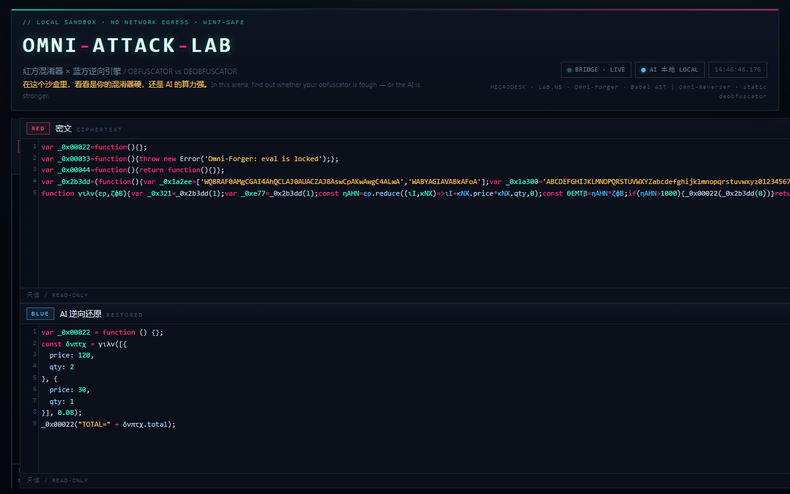

# ⚔️ Omni-Attack-Lab
## 红蓝对抗沙盒 · Visual AI Obfuscation & Reverse-Engineering Arena

> **Omni-Attack-Lab：在这个沙盒里，看看是你的混淆器硬，还是 AI 的算力强。**
>
> *Omni-Attack-Lab: in this arena, find out whether your obfuscator is tough — or the AI is stronger.*

一个 100% 本地运行的可视化对抗平台：左侧粘贴任意 JavaScript，点击「启动攻防对抗」，
红方（Omni-Forger · Babel AST 混淆器）先把它加密成密文，蓝方（Omni-Reverser 静态
逆向引擎 + 可选云端大模型）再尝试还原，最后并排展示「密文 / 还原代码」并给出
0–100 的**防御强度评分**与五维雷达图，每次回合生成可下载的 Markdown 战报。

A fully local, offline-first battle arena: paste raw JS on the left, hit **LAUNCH**,
the red team obfuscates it, the blue team (static deobfuscator + optional cloud LLM)
tries to restore it, and the lab scores the defense 0–100 with a 5-axis radar and a
downloadable Markdown battle report.



---

## ✨ 特性 / Features

- **三栏对抗面板 / Three-pane arena** — 原始代码（可编辑）· 红方密文 · 蓝方还原，纯 CodeMirror 5 离线 vendored。
- **真实引擎 / Real engines** — 红方复用 [dsh-omni-forger](vendor/dsh-omni-forger)（Babel AST：字符串数组加密 · 标识符重命名 · 死代码注入 · eval/console 掐断），蓝方复用 [dsh-omni-reverser](vendor/dsh-omni-reverser) 的 `deobfuscateJs`，并自研 **forger-vault 静态解包器**还原加密字符串。
- **确定性评分 / Deterministic scoring** — 红/蓝都不自评，相似度由 Dice + 结构 4-gram 等确定性算法计算，云端 AI 只参与还原、不许打分。
- **Markdown 战报 / Battle reports** — 每回合落盘 `reports/battle-report-*.md`，页内一键下载。
- **离线降级 / Graceful degradation** — 无引擎时自动进入明确标注的 **DEMO MODE**，内嵌完整演示数据。
- **Win7 友好 / Win7-safe** — 零 WebGL、零运行时 CDN、零重型框架；纯 DOM + 内联 SVG 雷达，在 Win7 时代的 Chromium 上流畅运行。

## 🏗 架构 / Architecture

```
lab-ui/        赛博朋克前端（CodeMirror 5 + 内联 SVG 雷达 + MicroDesk 浏览器 SDK）
lab-server/    MicroDesk RPC 桥接宿主（仅暴露 lab.status / lab.samples / lab.run）
lab-engine/    红蓝对抗核心
   ├ red.js      红方编排（forger 适配）
   ├ redguard.js 红方修复层（注入桩与重命名标识符撞名 → 自动修复，见下）
   ├ blue.js     蓝方流水线（vault 解包 → 反混淆 → 死代码剪枝 → 美化 → 可选 LLM）
   ├ vault.js    forger 字符串保险库静态解包器（不执行目标代码）
   ├ score.js    确定性相似度与防御评分
   ├ report.js   Markdown 战报生成
   ├ ai.js       可选云端蓝方（OpenAI / DeepSeek / Anthropic 兼容接口）
   └ samples.js  内置样本库
lab-report/    战报归档说明
docs/          RPC 契约（CONTRACT.md）· 截图
scripts/       依赖 vendor 脚本 · 撞名量化脚本
tests/         smoke 测试（引擎层 + WebSocket 端到端）
vendor/        micro-desk（RPC 内核）· dsh-omni-forger · dsh-omni-reverser · CodeMirror 5
```

## 🚀 快速开始 / Quick Start

```bash
npm install          # 安装 @babel/*（红方 AST 引擎依赖）
npm start            # 启动沙盒并打开窗口  →  http://127.0.0.1:7799
npm test             # 引擎层 + WebSocket 端到端冒烟测试（24 项断言）
npm run doctor       # 环境自检
node scripts/quantify-collisions.js   # 红方撞名率量化（11 样本 × 5 强度）
```

打开页面后：左侧粘贴代码（或选择内置样本）→ 调强度滑块（1–5）→ 点「⚔️ 启动攻防对抗」，
也可以按 `Ctrl+Enter` 发起。 `Ctrl+Shift+C` 清空日志。

## 📡 RPC 契约 / RPC Contract

前端通过 MicroDesk 的 WebSocket 桥（`/ws`）调用三个方法，契约冻结于
[docs/CONTRACT.md](docs/CONTRACT.md)：`lab.status` / `lab.samples` / `lab.run({code, intensity, ai})`。
桥的 `fs` / `exec` / `open` / `env` 权限**全部关闭**——页面无法触碰宿主文件系统。

## 📊 评分公式 / Scoring

`score = Σ(axis.value × weight)`，五轴全部由确定性算法计算（耗时轴按 `log10` 归一，仅此项随机器负载微漂）：

| 轴 axis | 权重 | 含义 |
|---|---|---|
| string 字符串加密 | 0.35 | 原文字符串字面量被蓝方找回的比例（越低分越高） |
| ident 标识符迷彩 | 0.20 | 原文标识符被找回的比例 |
| flow 控制流欺骗 | 0.15 | 死代码剪枝后与原文的结构相似度 |
| density 混淆密度 | 0.15 | Omni-Reverser 静态探测评分（hex 标识符密度等） |
| time 逆向耗时 | 0.15 | 蓝方耗时相对红方的对数压力 |

等级 / Grade：**S** ≥ 85 混淆器碾压 · **A** ≥ 70 混淆器占优 · **B** ≥ 55 势均力敌 · **C** ≥ 40 逆向器占优 · **D** < 40 明文裸奔。

## 🔬 实测结论 / Measured Results

内置 3 样本 × 强度 1–5 的本地静态蓝方对抗（无云端 AI）：

| 强度 | L1 | L2 | L3 | L4 | L5 |
|---|---|---|---|---|---|
| 得分区间 | 8 (D) | 8–10 (D) | 35 (D) | **56–61 (B)** | 36–37 (D) |

- 本地静态蓝方在 L1–L3 碾压红方（字符串 100% 还原）；
- **L4 是对静态蓝方的最佳防御**；
- L5 的 Unicode 标识符会绕过 hex 标识符启发式、压低 density 轴，总分反而回落——真实且有趣的对抗动态。
- 配置云端大模型后蓝方语义还原能力显著增强（见下）。

**红方修复层（redguard）**：探针发现 Omni-Forger 在强度 ≥3 时注入桩池与重命名池确定性相撞
（11/11 样本顶层重复绑定，`const`/`var` 冲突直接 SyntaxError）。`lab-engine/redguard.js`
自动重命名孤儿桩并把被丢弃的 console 换桩调用重路由，修复后 **55/55（100%）** 恢复语义等价。

## ☁️ 可选：云端蓝方 / Optional Cloud Blue Team

默认纯本地（结果可复现）。设置任一环境变量即可启用云端语义精修（仅还原，不评分）：

```bash
set OMNI_AI_API_KEY=sk-...         # OpenAI 兼容接口（配合 OMNI_AI_BASE_URL / OMNI_AI_MODEL）
set DEEPSEEK_API_KEY=sk-...        # 或直连 DeepSeek / OpenAI / Anthropic 官方
```

## 🧩 复用与致谢 / Vendored From

- [micro-desk](lab-server/vendor/micro-desk) —— 零依赖本地 HTTP + WebSocket RPC 内核
- [dsh-omni-forger](vendor/dsh-omni-forger) —— 红方 Babel AST 混淆引擎
- [dsh-omni-reverser](vendor/dsh-omni-reverser) —— 蓝方静态反混淆引擎
- [CodeMirror 5.65.16](lab-ui/vendor/codemirror) —— 离线代码编辑器

## 📜 License

MIT — 见 [LICENSE](LICENSE)。 vendored 组件保留其原始 MIT 许可。
